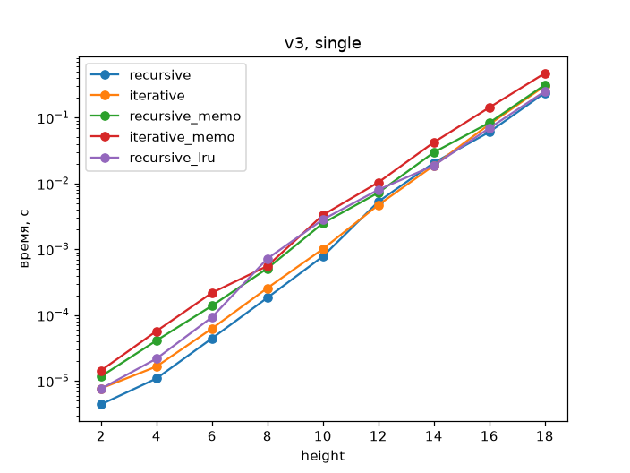
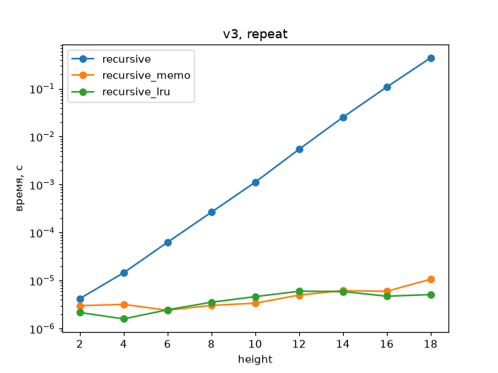
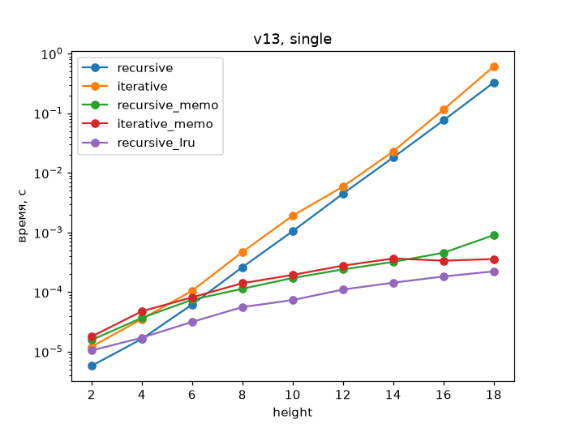
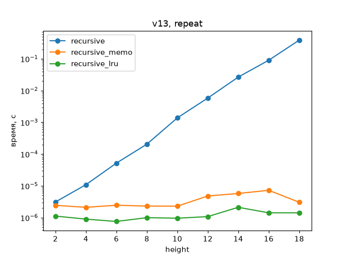

# ЛР 5. Мемоизация gen_bin_tree

- **Вариант 3:** `root = 3`, `height = 4`, `left_leaf = x + 2`, `right_leaf = x * 3`
- **Вариант 13:** `root = 13`, `height = 3`, `left_leaf = x + 1`, `right_leaf = x - 1`
  
## Файлы
- `memo_tree.py` - `memoize`, исходные функции из ЛР 3 и ЛР 4, мемоизованные версии, версия на `lru_cache`;
- `test_memo_tree.py` - тесты (`python -m unittest -v`; в Colab: `unittest.main(argv=[''], verbosity=2, exit=False)`);
- `benchmark.py` - замеры `timeit`, графики, подсчёт вызовов, `cache_info()`;
- `plot_v3_single.png`, `plot_v3_repeat.png`, `plot_v13_single.png`, `plot_v13_repeat.png` - графики.

## Методика
Высоты 2, 4, ..., 18 передаются явно (высота из варианта - только значение по умолчанию).
**Верхняя граница - 18**: одно построение без мемоизации занимает при этом
около 0,15-0,25 с (<1 с; при 20 уже 1,5-4 с). Замер - `timeit.repeat(number=1, repeat=5)`,
среднее. «Одно построение»: `cache_clear()` в `setup`. «Повторный вызов»: первое
построение в `setup`, замеряется второе (только для версий с кэшем между вызовами;
`recursive` - для сравнения). У `iterative_memo` кэш локальный, в этом сценарии он не участвует.
Ось Y логарифмическая: значения различаются на порядки.

## Результаты (мс)

| вариант | сценарий | height | recursive | iterative | recursive_memo | iterative_memo | lru_cache |
|---|---|---|---|---|---|---|---|
| 3 | одно построение | 10 | 0.43 | 0.71 | 1.16 | 0.78 | 0.41 |
| 3 | одно построение | 16 | 42.7 | 49.6 | 60.4 | 40.2 | 21.1 |
| 3 | одно построение | 18 | 196 | 240 | 228 | 181 | 129 |
| 3 | повторный вызов | 18 | 184 | - | 0.004 | - | 0.003 |
| 13 | одно построение | 10 | 0.36 | 0.45 | 0.063 | 0.037 | 0.021 |
| 13 | одно построение | 16 | 30.0 | 39.9 | 0.161 | 0.091 | 0.048 |
| 13 | одно построение | 18 | 161 | 194 | 0.204 | 0.108 | 0.060 |
| 13 | повторный вызов | 18 | 142 | - | 0.001 | - | <0.001 |

Число вызовов `left_leaf` (столько же `right_leaf`) и различных узлов (h = 16):

| вариант | без мемоизации | с мемоизацией | узлов без / с |
|---|---|---|---|
| 3 | 65535 | 32936 | 131071 / 60629 |
| 13 | 65535 | 136 | 131071 / 153 |

`lru_cache.cache_info()` при h = 16: вариант 3 - `hits=5244, misses=60629`;
вариант 13 - `hits=120, misses=153`. Промахов ровно столько, сколько различных узлов.

## Графики
Вариант 3, одно построение:

Вариант 3, повторный вызов:

Вариант 13, одно построение:

Вариант 13, повторный вызов:

## Запуск
pip install matplotlib
python -m unittest test_memo_tree.py -v
python benchmark.py

## Общие узлы: чем опасно
С мемоизацией одинаковые поддеревья - один объект (`t["left"]["right"] is
t["right"]["left"]`, см. тесты). Изменение узла в одном месте меняет дерево
сразу в нескольких, а кэш между вызовами отдаёт тот же (уже испорченный) объект
и при следующем вызове. Как избежать: не менять результат (неизменяемые узлы,
например `namedtuple`), либо перед изменением делать независимую копию (`deepcopy`
сохраняет общие узлы внутри копии, поэтому нужен обход с созданием новых узлов),
либо не хранить кэш между вызовами (`cache_clear()`, локальный кэш как в `iterative_memo`).

## Выводы
**1. Во сколько раз ускоряет мемоизация?** Вариант 13, h = 18: в ~800 раз у
`recursive_memo` (161 -> 0,204 мс), в ~1800 у `iterative_memo` (194 -> 0,108 мс),
в ~2700 у `lru_cache`; ускорение растёт с высотой, т.к. узлов без кэша 2^h, а
различных - около h². Вариант 3: на одном построении ускорения почти нет
(h = 16: `recursive_memo` в 0,7 раза, т.е. медленнее; `iterative_memo` 1,2x;
`lru_cache` 2x). Причина: в варианте 3 общих поддеревьев мало (при h = 16 различных
узлов 60 629 из 131 071), а `x + 1` / `x - 1` в варианте 13 даёт много совпадений
(«влево-вправо» = «вправо-влево»). При повторном вызове с теми же аргументами
выигрыш огромный в обоих вариантах (вариант 3, h = 18: ~46 000x), т.к. берётся готовое дерево.

**2. Когда мемоизованная версия медленнее?** Вариант 3: `recursive_memo` медленнее
обычной на замеренных высотах 10, 16, 18 (и на малых тоже, см. график): на каждый
вызов тратится построение ключа `(args, sorted(kwargs))`, поиск и запись в словарь,
обновление счётчиков, а экономия мала; на больших высотах добавляется рост кэша
(память). В варианте 13 мемоизация проигрывает разве что на самых малых высотах,
где дерево строится за микросекунды (см. график).

**3. Почему `memoize(gen_bin_tree_recursive)` не помогает, а `@memoize` помогает?**
В первом случае кэшируется только внешний вызов обёртки, а внутри функция
рекурсивно вызывает по глобальному имени `gen_bin_tree_recursive` - исходную,
не мемоизованную. Во втором имя в теле указывает на обёртку, и каждый рекурсивный
вызов идёт через кэш.

**4. `memoize` и `lru_cache`.** `lru_cache` быстрее (вариант 13, h = 18: 0,06 мс
против 0,20 мс; вариант 3, h = 16: 21 против 60 мс): он реализован на C, ключ строится
без Python-кода, нет Python-счётчиков и `sorted(kwargs)`. Наш декоратор нагляднее,
но каждый вызов выполняет Python-код обёртки.

**5. Новая lambda при каждом вызове.** Функции входят в ключ кэша, а две одинаковые
по тексту lambda - разные объекты, поэтому между вызовами попаданий нет (только
внутри одного вызова), а кэш `memoize` растёт без ограничений (утечка памяти;
`lru_cache(maxsize=None)` ведёт себя так же, при заданном `maxsize` старые записи
вытесняются). Решение: определять функции один раз и передавать их же.
